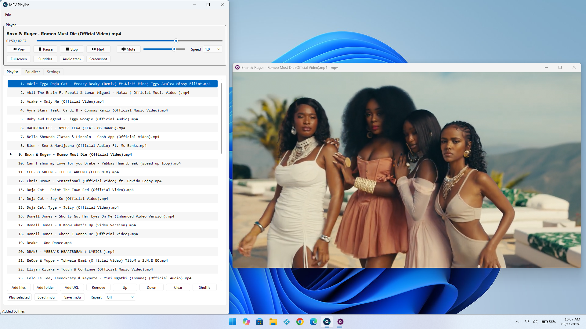

# MPV Playlist



## Setup and packaging

MPV Playlist uses PySide6 for its interface. Install dependencies in a virtual environment, then launch the app:

```sh
Package                   Version
------------------------- ----------
altgraph                  0.17.5
Nuitka                    4.3.4
packaging                 26.3
patchelf                  0.19.1.0
pip                       26.2.2
psgdnd                    6.0.6
pyinstaller               6.22.3
pyinstaller-hooks-contrib 2026.7
PySide6                   6.12.0
PySide6_Addons            6.12.0
PySide6_Essentials        6.12.0
PySide6_Pdf               6.12.0.140
PySide6_WebEngine         6.12.0.140
pysimplegui               6.3.16
setuptools                84.2.1
shiboken6                 6.12.0
tkinterdnd2               0.6.3
```

### Ubuntu

```sh
.venv/bin/python mpv_playlist.py

.venv/bin/pyinstaller mpv_playlist.py
```

### Windows

```sh
python mpv_playlist.py

pyinstaller --noconsole --icon=mpvl.ico --add-data="mpvl.ico;." mpv_playlist.py
```

## What it does

- **Player controls:** play/pause, stop, previous/next, a seek bar, volume, mute, speed, fullscreen, subtitle and audio-track cycling, and screenshot. It starts its own mpv window and still loads your `mpv.conf`, so `hwdec=vaapi`, your geometry and your subtitle font apply as usual.
- **Playlist tab:**
  - Add files, add a folder (naturally sorted), or add a URL (yt-dlp, using your `ytdl-format`).
  - Remove, move up/down, clear, shuffle, and double-click to play.
  - Repeat modes (off / playlist / current file) and load/save `.m3u`.
- **Equalizer tab:** ten sliders at your exact bands (31 Hz to 16 kHz, ±12 dB), an enable toggle, and presets that include “My mpv.conf curve” (your current gains). Changes apply live through a labelled `@eq` filter, so it doesn’t clash with your profile-based `af-add` entries. “Copy mpv.conf lines” puts matching ON/OFF `af-add`/`af-remove` lines on your clipboard.
- **Settings tab:** edits `hwdec`, `hwdec-codecs`, geometry, screenshot directory, `ytdl-format` and the subtitle options.
  - “Apply” pushes them to the running mpv.
  - “Save” rewrites only the global section above your first `[profile]` and keeps a backup as `mpv.conf.bak`. Your `[music]` and `[movie]` profiles are untouched.

## Things to know

- Geometry only takes effect when mpv starts, and `hwdec` applies from the next file loaded.
- EQ gains and volume are remembered in `./state.json`.
- If you close the mpv window, the frontend restarts it and restores the playlist the next time you use a control.
- Your `[music]` profile uses `profile-cond`. If mpv’s profile switching also adds its own EQ filters, you’d hear both. Turn the frontend equalizer off if the sound is boosted twice.

## Windows support

- **Connection to mpv:** the Linux version used a unix socket, which mpv doesn’t offer on Windows. It now connects over a named pipe on Windows and keeps the socket on Linux. The Windows reader only reads when data is waiting, so a pending read can’t block commands you send from the GUI.
- **Finding mpv:** it looks for `mpv.exe` next to the script first, then on `PATH`, then in the usual Scoop and Program Files folders. If none is found, you get a clear message instead of a crash.
- **Where mpv.conf lives:** it uses `%APPDATA%\mpv\mpv.conf` on Windows. If `mpv.exe` has a `portable_config` folder beside it, that folder is used instead.
- **Settings defaults:**
  - `hwdec` defaults to `auto-safe` on Windows, since `vaapi` doesn’t exist there, and the dropdown lists Windows options such as `d3d11va` and `nvdec`.
  - The screenshot folder default is an absolute path.
  - Backslashes in the screenshot folder are written as `/` when saving to `mpv.conf`.
  - Reading `mpv.conf` now tolerates a byte-order mark from Windows editors.
- **Look on Windows:** fonts switch to Segoe UI and Consolas, and the app asks Windows for sharp text on high-DPI screens. Single-letter drive paths like `C:/x` are no longer mistaken for URLs.

**state.json**
It is saved as `state.json` in the same folder as the script (or the `.exe` if you package it). The load and save code no longer creates any folders. If you put the script somewhere read-only, such as Program Files, saving fails silently and the equalizer and volume aren’t remembered.

**On Windows**

- For YouTube and other URLs, put `yt-dlp.exe` next to `mpv.exe` or on `PATH`.
- The setup steps for both platforms are in the file’s docstring.


## Features

- **Browse file picker:** it uses the native Open, Save and Folder dialogs. Add files supports multi-select and has a media filter, and the dialogs remember the last folder you used. Add URL is pre-filled if your clipboard holds a link, and the subtitle font is a drop-down of installed fonts.
- **Drag and drop:**
  - **Dropping in:** you can drop files, folders, `.m3u` playlists or URLs onto the playlist or anywhere on the window. A dropped folder includes its subfolders. A dropped `.srt`, `.ass` or `.vtt` loads as a subtitle track.
  - **Placement:** a line shows where the items will land, and they are inserted there.
  - **Reordering:** you can drag entries inside the list to reorder them. The list stays in step with mpv, because Qt only reports the drop and the app sends the move commands.
  - **Safety:** drops are always accepted as a copy, so a file manager can’t delete your originals.
- **Right-click menu:**
  - **On selected entries:** Play, Remove, Move (up, down, top, bottom), Show in folder, and Copy path or URL.
  - **Always shown:** the add options, Paste, Select all, Shuffle and Clear.

## Other Features

- **Keyboard shortcuts:** Ctrl+O, Ctrl+Shift+O, Ctrl+U, Ctrl+V, Enter and Delete.
- **Seek bar:** you can click anywhere on it to jump there.
- **Equalizer:** it has live dB readouts, and double-clicking a slider resets it.
- **Window:** it follows the playing track and remembers its size.
- **Misc:** mpv.conf editing, the equalizer filter, the Windows named pipe, and the `state.json` location.
- **Dropped:** the DPI call, since Qt handles scaling itself, and the DPI workarounds. The Tk dependency is gone, but on X11 Qt needs `libxcb-cursor0` (`sudo apt install libxcb-cursor0`).

Setup is `pip install PySide6`, then `python mpv_playlist.py`

**What to look for when you run it:** the drop-position line, reordering by drag, and that the Windows pipe still works. If anything in the Qt layer misbehaves, check the traceback.

The theme is the system’s native.


&nbsp;
